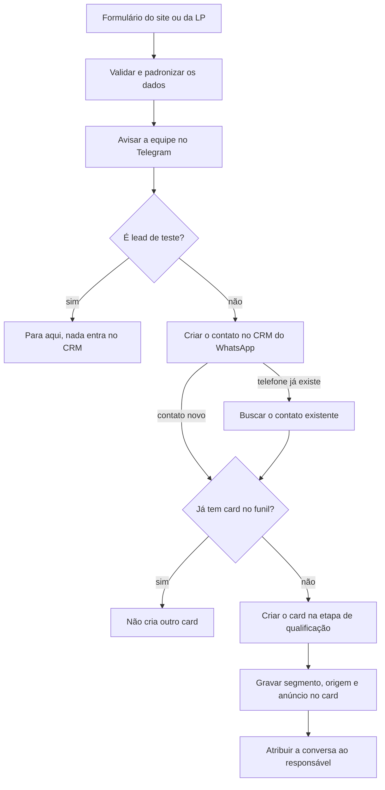

# Fluxo n8n: do formulário do site ao funil do WhatsApp

Este é o fluxo que eu implanto quando o cliente capta lead por formulário (site ou landing page) e atende pelo WhatsApp.

O problema que ele resolve é comum: o formulário chega num e-mail que ninguém olha, ou cai numa planilha, e o lead esfria antes do primeiro contato. Com o fluxo, a equipe recebe o aviso na hora, o lead entra no funil do CRM sem duplicar e a origem do anúncio fica registrada no card.

## O que acontece quando alguém envia o formulário



1. **O formulário envia os dados para o n8n.** Junto com nome e WhatsApp vão a página de origem, os parâmetros do anúncio (UTM) e os identificadores de clique da Meta (`fbc` e `fbp`).
2. **O fluxo valida e padroniza.** O telefone vira formato internacional (+55 e DDD). Telefone com número de dígitos impossível é recusado, para não criar contato inválido no CRM.
3. **A equipe recebe o aviso no Telegram.** O aviso leva o nome, um link que abre a conversa no WhatsApp com um toque, o interesse do lead, o anúncio de origem e o prazo de resposta combinado.
4. **Lead de teste para aqui.** Envio marcado como teste gera o aviso com a etiqueta [TESTE], mas não entra no CRM. Assim dá para testar o formulário sem sujar o funil.
5. **O contato é criado no CRM do WhatsApp.** Se o telefone já existe, o fluxo busca e reaproveita o contato em vez de criar outro.
6. **O fluxo confere se esse contato já tem card no funil.** Quem envia o formulário duas vezes não gera dois cards.
7. **O card entra na etapa de qualificação**, com segmento, origem (topo ou fim da página, site ou LP) e o anúncio que trouxe o lead.
8. **A conversa é atribuída ao responsável**, para o lead não ficar sem dono.

## Decisões de desenho

- **O aviso sai antes do CRM.** Se o CRM estiver fora do ar, a equipe ainda sabe do lead e consegue chamar. O lead nunca se perde.
- **Telefone é a chave do contato.** No WhatsApp o telefone identifica a pessoa. Nome e e-mail variam de um envio para outro.
- **A origem fica gravada no card, não só no aviso.** Assim, no fim do mês, dá para cruzar venda por anúncio no CRM em vez de depender só do número da Meta.
- **`fbc` e `fbp` são guardados no envio.** Quando o lead vira venda, esses dados permitem devolver a venda para a Meta pela API de Conversões e ligar a venda ao clique.

## Exemplo de aviso para a equipe

Dados fictícios.

```
Lead novo na LP

Maria Souza
(61) 99999-0000 · WhatsApp
Loja Centro · Varejo
Plano de interesse: Mensal

Anúncio: meta / campanha-lojas / video-depoimento

Formulário do topo
Chamar em até 1 hora útil.
```

## O que o formulário precisa enviar

| Campo | Para que serve |
|---|---|
| nome | Nome do contato e do card |
| whatsapp | Chave do contato no CRM |
| interesse | Prioridade no atendimento |
| página e origem | Saber qual página e qual formulário converte |
| UTMs | Saber qual anúncio trouxe o lead |
| fbc e fbp | Devolver a venda para a Meta depois |
| teste | Testar o formulário sem entrar no CRM |

## Como eu valido antes de ligar

1. Envio um lead marcado como teste e confiro o aviso no Telegram.
2. Envio um lead real com um telefone meu e confiro o contato, o card e os campos no CRM.
3. Envio o mesmo telefone de novo e confiro que não nasceu um segundo card.
4. Confiro se o anúncio de origem apareceu no card.

## Ferramentas

n8n, CRM de atendimento do WhatsApp (base Chatwoot) com funil em kanban e Telegram para os avisos da equipe.

---

Kallebe Alves · Gestor de Tráfego Pago e Automação de Marketing · [portfolio.vyzar.com.br](https://portfolio.vyzar.com.br)
